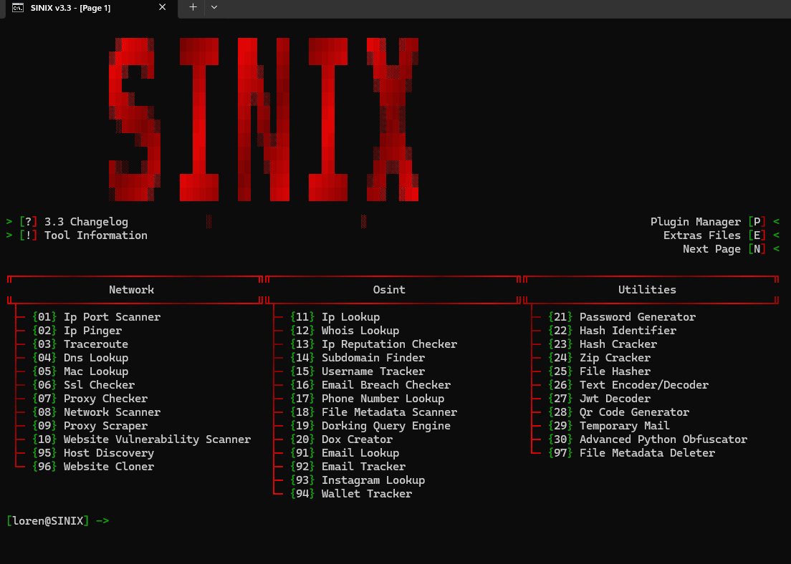

\# ⚡ SINIX-MULTITOOLS v9 




&#x20; <b>Boîte à outils multifonctionnelle avancée orientée cybersécurité, OSINT et automatisation.</b>

</p>


\---


\## 🚀 À propos du projet

\*\*Sinix-multitools\*\* est une suite complète d'utilitaires et de scripts développés pour divers scénarios de test, d'analyse et de gestion de services (notamment orientés autour d'outils OSINT, de scripts Discord et d'utilitaires réseau). Cette version intègre également des modules inspirés de l'écosystème \*Fsociety\*.


\---


\## 📁 Structure du projet

\* \*\*`Programs/`\*\* : Contient l'ensemble des scripts et modules spécialisés :

&#x20; \* \*\*OSINT \& Reconnaissance\*\* : Outils de recherche de noms d'utilisateurs, d'emails et de traçage de cibles.

&#x20; \* \*\*Réseau \& Sécurité\*\* : Scanners de ports, outils de découverte d'hôtes et tests d'administration réseau.

&#x20; \* \*\*Utilitaires Discord\*\* : Scripts d'automatisation, de gestion et d'interaction pour serveurs et tokens.

&#x20; \* \*\*Intégrations Fsociety\*\* : Modules d'exploitation et d'analyse issus de l'écosystème Fsociety.

\* \*\*`Setup.py` \& `lancer.bat`\*\* : Scripts d'installation des dépendances et de lancement rapide de l'application.


\---


\## ⚙️ Installation \& Démarrage \& Technologies


```bash

\# 1. Cloner le dépôt :

git clone \[https://github.com/L3X667/Sinix-multitools.git](https://github.com/L3X667/Sinix-multitools.git)

cd Sinix-multitools


\# 2. Installer les dépendances :

\# Assurez-vous d'avoir Python installé, puis exécutez le script d'installation ou installez les prérequis :

pip install -r requirements.txt


\# 3. Lancer l'outil :

\# Exécutez le fichier principal de lancement :

\# Sous Windows : Double-cliquez sur lancer.bat ou lancez via le terminal :

python Sinix.py


\# 🛠️ Technologies utilisées :

\# - Langage principal : Python

\# - Plateforme : Compatible Windows / Linux (selon les modules)


